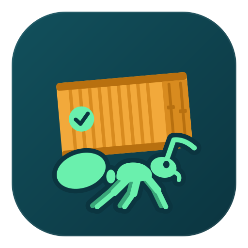

<div align="center">
  <a href="https://jonasheinle.de">
    
  </a>

  <h1>ANTfrastructure</h1>

  <h4>The build images, CI actions, reusable workflows and quality gates every Kataglyphis repository builds on.</h4>
</div>

[](https://github.com/Kataglyphis/ANTfrastructure/actions/workflows/linux-x64.yml)
[](https://github.com/Kataglyphis/ANTfrastructure/actions/workflows/windows-x64.yml)
[](https://github.com/Kataglyphis/ANTfrastructure/actions/workflows/windows-arm64.yml)
[](https://github.com/Kataglyphis/ANTfrastructure/actions/workflows/ghcr-cleanup.yml)
[](https://github.com/Kataglyphis/ANTfrastructure/actions/workflows/consumer-inventory.yml)
[](https://github.com/Kataglyphis/ANTfrastructure/actions/workflows/actions-selftest.yml)
[](https://www.paypal.com/paypalme/JonasHeinle)

ANTfrastructure builds the Linux and Windows Server Core images that every Kataglyphis repository compiles in:
pinned GCC and LLVM, Vulkan, MSVC, media and inference libraries, and an arm64 artifact bundle. Its actions, workflows,
shell libraries and quality gates serve the family at `@develop`. The [docs site](https://containerization.jonasheinle.de) has every guide.

## Highlights

- One multi-arch `:latest` for Linux: ONNX Runtime with GenAI, OpenCV, FFmpeg, GStreamer, LiteRT, TVM and IREE.
- Accelerator images: Hailo-10H in `:latest`, CUDA and DeepStream in `:latest-nvidia`, MIGraphX in `:latest-rocm`.
- A Windows build image, `:winamd64`, with MSVC, clang-cl, DirectML and HailoRT; `:winarm64` is its arm64 bundle.
- Composite actions, reusable workflows and shell and PowerShell libraries that every repository calls.
- Gates that fail loudly: preflight, ratchets, mutation proofs and package checks, here and in every consumer.
- Home-lab stacks, deliberately here: Ollama with Open WebUI, Home Assistant, Nextcloud AIO and Ansible.

## Quick start

```bash
# use the image; its default CMD is a shell
nerdctl run -it --rm ghcr.io/kataglyphis/kataglyphis_beschleuniger:latest
git clone --recurse-submodules --branch develop https://github.com/Kataglyphis/ANTfrastructure.git
cd ANTfrastructure
bash linux/scripts/build-cross-chain.sh --target-arches amd64,arm64,riscv64 --log-dir ./logs/build-logs
```

```pwsh
.\windows\Build-Buildkit.ps1          # the Windows image, :winamd64 (non-admin shell; -Gpu for :winamd64-nvidia)
```

A fresh host starts at [Linux Host Setup](docs/linux-host-setup.md) or [Windows Host Setup](docs/windows-host-setup.md).

## Published images

Registry `ghcr.io/kataglyphis/kataglyphis_beschleuniger`, one manifest per tag over every architecture of its variant
([AGENTS.md § Image and tag naming](AGENTS.md#image-and-tag-naming-published-tags)).
Every tag and the GPUs `:latest-nvidia` runs on: [overview](docs/overview.md#published-images-and-tag-hints).

| Tag | What |
| --- | --- |
| `:latest` | Linux **manifest** over amd64, arm64 and riscv64; the Hailo runtime on amd64 and arm64 |
| `:latest-nvidia` | CUDA/TensorRT plugin EPs, cuDNN and DeepStream 9.1; amd64 and arm64 ([acceptance](docs/image-acceptance.md#evidence-and-limits)) |
| `:latest-rocm` | ROCm and the [plugin MIGraphX EP](docs/linux-accelerator-images.md#amds-plugin-migraphx-ep), amd64 |
| `:winamd64` | Windows **manifest** (`windows/amd64`), CPU + DirectML; `:winamd64-nvidia`, `:winamd64-rocm` |
| `:winarm64` | Windows arm64 **artifact bundle**: a `windows/amd64` image, never `--platform windows/arm64` |

## Documentation

| I want to… | Read |
| --- | --- |
| Find a topic, or see what is published | [INDEX.md](docs/INDEX.md) · [Overview](docs/overview.md) |
| Wire a new project, or reuse a shared script | [Adoption](docs/adopting-in-a-new-project.md) · [Shared libraries](docs/shared-script-libraries.md) |
| Upgrade dependencies, in one repo or in all of them | [Dependency updates](docs/dependency-updates.md) |
| Build the Linux images | [Basics](docs/linux-build-basics.md) · [Cross builds](docs/linux-cross-builds.md) |
| Build and accept the accelerator images | [Accelerators](docs/linux-accelerator-images.md) · [Acceptance](docs/image-acceptance.md) |
| Build the Windows image and its arm64 bundle | [Windows builds](docs/windows-builds.md) · [Invariants](docs/windows-build-invariants.md) |
| Package an app and check its licences | [Python app bundles](docs/python-app-bundles.md) · [Licences](docs/third-party-licenses.md) |
| Run the local proofs and the hub's own tools | [Local proofs](docs/local-proof-workflows.md) |
| Know every quality gate and its exceptions | [Quality tooling](docs/code-quality-tooling.md) · [Gate registry](docs/code-quality-gates.md) |
| Write a docs page, a rule or a README | [Writing docs](docs/writing-docs.md) · [Family rules](docs/repository-family.md) |
| Serve LLMs on the family's reference server | [linux/llm-stack/README.md](linux/llm-stack/README.md) |
| Run a coding agent on-device on a Snapdragon (GenieX) | [GenieX setup](docs/geniex-local-ai-setup.md) |
| Read the rules and the owner's decisions | [AGENTS.md](AGENTS.md) · [Decisions](docs/decisions.md) |
| Find open work, changes and error messages | [BACKLOG.md](BACKLOG.md) · [CHANGELOG.md](CHANGELOG.md) · [Failure modes](docs/failure-modes.md) |

<!-- generated:version-snapshot:start -->
## Source-Controlled Version Snapshot

This block is generated from the Dockerfiles and setup scripts by `python3 docs/scripts/sync_versions.py --write`.

| Target | Source-controlled defaults |
| --- | --- |
| Linux base image | Ubuntu 26.04, LLVM/Clang 23.1.5, GCC 16, CMake 4.4.5, Vulkan SDK 1.4.363.0 |
| Android layer | Android SDK 15859902, NDK 30.0.16248370, CMake 4.1.2 |
| Webserver image | Ubuntu 26.04 |
| Windows build image | Windows Server Core LTSC 2025, Visual Studio Build Tools 18, Vulkan SDK 1.4.363.0, GStreamer 1.29.2, CUDA 13.4.3, ONNX Runtime v1.31.1 |
<!-- generated:version-snapshot:end -->

## Contributing and contact

Reuse the shared functionality first, and run `make hooks` and `make preflight` before a push. See the
[adoption rules](docs/adopting-in-a-new-project.md#reuse-before-adding-functionality), the [family rules](docs/repository-family.md)
and [AGENTS.md § Validation](AGENTS.md#validation). Licence: MIT, see [LICENSE](LICENSE).
