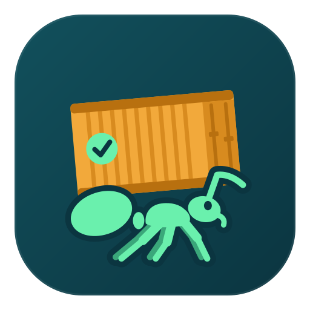

<div align="center">
  <a href="https://jonasheinle.de">
    
  </a>

  <h1>ANTfrastructure</h1>

  <h4>The build images, CI actions, reusable workflows and quality gates every Kataglyphis repository builds on.</h4>
</div>

[](https://github.com/Kataglyphis/ANTfrastructure/actions/workflows/linux-x64.yml)
[](https://github.com/Kataglyphis/ANTfrastructure/actions/workflows/windows-x64.yml)
[](https://github.com/Kataglyphis/ANTfrastructure/actions/workflows/windows-arm64.yml)
[](https://github.com/Kataglyphis/ANTfrastructure/actions/workflows/ghcr-cleanup.yml)
[](https://github.com/Kataglyphis/ANTfrastructure/actions/workflows/consumer-inventory.yml)
[](https://github.com/Kataglyphis/ANTfrastructure/actions/workflows/actions-selftest.yml)
[](https://www.paypal.com/paypalme/JonasHeinle)

[**Docs site**](https://containerization.jonasheinle.de)

Prebuilt Linux and Windows Server Core images provide GCC, LLVM/Clang, Vulkan, MSVC,
media and inference libraries, nginx, and an arm64 artifact bundle. The composite
actions, reusable workflows, shell libraries and gates serve the family at `@develop`.

## Highlights

- **One multi-arch `:latest`** for Linux: ONNX Runtime (+GenAI), OpenCV, FFmpeg, GStreamer, LiteRT, TVM, IREE ([GenAI smoke contract](docs/gen1-riscv64-genai.md); [RISC-V cross tests](docs/riscv64-cross-test-lanes.md#the-pieces)).
- **A Windows build image**, `:winamd64`, with MSVC, clang-cl, DirectML and HailoRT; `:winarm64` is its arm64 bundle.
- **Accelerators**: Hailo-10H in `:latest`, CUDA and DeepStream in `:latest-nvidia`, MIGraphX in `:latest-rocm`.
- **Python GPU bundle checks** require the requested provider and check relocatable native dependencies; an opt-in host SDK mode records required GPU libraries. See [GPU bundle limits](docs/python-app-bundles.md#linux-gpu-bundles).
- **GPU AppImage checks** match the finished ONNX Runtime core, provider and notices to one unstripped wheel and reject bundled host SDK libraries; see [package licence checks](docs/third-party-licenses.md#checking-delivered-package-licences).
- **GPU package receipts** bind exact package bytes to an explicit CI identity and named check; see their [trust and verification limits](docs/gpu-artifact-receipts.md).
- **Release asset collection** excludes draft candidate, unverified and inventory-only uploads; see [release collection](docs/branch-and-release-strategy.md#collecting-the-release-files).
- **Portable DEB archives** use gzip compression for older Debian package managers; Python dependency scans reject incompatible bundled ELF identities, ambiguous host package owners and unproven earlier library search paths, with remaining runtime limits described in [Python packages](docs/python-app-bundles.md#packages).
- **Reusable CI and Python setup**: workflows, locked cmake-format and dartdoc tools, dependency environments, image-backed overlays isolated from conflicting uv project settings and [consumer inventory](docs/consumer-inventory.md); Linux Python sync accepts LF and CRLF locks. See [Python CI](docs/python-ci.md).
- **Dependency updates**: the local Renovate driver can select exact direct submodule paths; see [dependency updates](docs/dependency-updates.md#how-the-submodule-half-follows-default-branches).
- **Windows host maintenance**: inspect Stevedore images, containers and build cache with the reusable [inventory tool](docs/windows-stevedore-and-docker.md#stevedore-disk-inventory) before choosing a cleanup.
- **Gates that fail loudly**: preflight, mutation proofs, consumer pin checks ([uv exclusions](docs/code-quality-tooling.md#consumer-pins-and-uv-exclusions)) and runtime smokes ([ORT census](docs/failure-modes.md#the-torch-stage-fails-with-ort-census-fail)); active `develop` proofs finish before the latest queued push ([CI triggers](docs/ci-build-triggers.md#this-repositorys-lanes)). Windows test result paths are created when needed, and interrupted job waits preserve real statuses ([test reports](docs/code-quality-tooling.md#windows-pester-coverage)).
- **Home-lab stacks, deliberately here**: an Ollama + Open WebUI server, Home Assistant, Nextcloud AIO, Ansible, [weekly backups to the NAS](linux/ansible/README.md#backups-to-the-nas).

## Quick start

```bash
# use the image; its default CMD is a shell
nerdctl run -it --rm ghcr.io/kataglyphis/kataglyphis_beschleuniger:latest
git clone --recurse-submodules --branch develop https://github.com/Kataglyphis/ANTfrastructure.git
cd ANTfrastructure
bash linux/scripts/build-cross-chain.sh --target-arches amd64,arm64,riscv64 --log-dir ./logs/build-logs
```

```pwsh
.\windows\Build-Buildkit.ps1          # the Windows image, :winamd64 (non-admin shell; -Gpu for :winamd64-nvidia)
```

A fresh host starts at [Linux Host Setup](docs/linux-host-setup.md) or [Windows Host Setup](docs/windows-host-setup.md).
From Ubuntu WSL2, run `bash linux/scripts/wsl-quality.sh setup` to install pinned tools, then `bash linux/scripts/wsl-quality.sh check --jobs 4` to run Linux and PowerShell checks with bounded workers. Windows-only tests use native Windows PowerShell; [script tests and coverage](docs/code-quality-tooling.md#windows-pester-coverage). Use `bash linux/scripts/refactor-python.sh --root <checkout> --check` to preview another repo's Python format debt, or `--apply -- path/to/file.py` to create a reviewable fix. Consumers call the reusable report, locked Ruff and ty, refactor, mutation and PowerShell workflows at `@develop`; [quality tooling](docs/code-quality-tooling.md#python-refactor-preview) and [adoption](docs/adopting-in-a-new-project.md#9-quality-gates). [Runtime heartbeat cleanup](docs/cross-build-verification.md#measuring-the-torch-runs-wait-before-uv-venv) and [plugin scan verdicts](docs/cross-build-verification.md#smoke-media-the-mandatory-plugin-gate-and-its-build-sandbox-deferrals) are regression-tested. Generated reports go in ignored `logs/`.

## Published images

Registry `ghcr.io/kataglyphis/kataglyphis_beschleuniger`, one manifest per tag over every architecture of its variant
([AGENTS.md § Image and tag naming](AGENTS.md#image-and-tag-naming-published-tags)). Every tag, the accelerator matrix and the GPUs `:latest-nvidia` runs on: [docs/overview.md](docs/overview.md#published-images-and-tag-hints).

| Tag | What |
| --- | --- |
| `:latest` | Linux **manifest** over amd64, arm64 and riscv64; the Hailo runtime on amd64 and arm64 |
| `:latest-nvidia` | CUDA, cuDNN and DeepStream 9.1, amd64 |
| `:latest-rocm` | ROCm and MIGraphX, amd64 |
| `:winamd64` | Windows **manifest** (`windows/amd64`), CPU + DirectML; `:winamd64-nvidia`, `:winamd64-rocm` |
| `:winarm64` | Windows arm64 **artifact bundle**: a `windows/amd64` image, never `--platform windows/arm64` |

## Documentation

| I want to… | Read |
| --- | --- |
| Find a topic, see what is published or build the docs locally | [docs/INDEX.md](docs/INDEX.md) · [Overview](docs/overview.md) · [Locked docs setup](docs/project-info.md#building-the-hubs-docs) |
| Wire a new project, pin one direct submodule to its remote default tip, or reuse build, installer, MSIX smoke, image-Python, discovery, reporting, process and test-fixture helpers | [Adoption](docs/adopting-in-a-new-project.md#bumping-the-pin) · [Shared libraries](docs/shared-script-libraries.md#python-interpreter-probe-01-corepython-probesh) · [Synthetic test fixtures](docs/shared-script-libraries.md#shared-synthetic-test-fixtures) · [Image defaults](.github/actions/README.md#the-two-images-and-the-one-place-they-are-named) |
| Upgrade dependencies in one repo or every active, nonfork owned repo; the driver checks the latest Renovate CLI, updates direct submodules to remote default tips, and includes the required Torch/vision Git lookups in a scoped Python scan. Tracked security locks and wheel hashes move together | [docs/dependency-updates.md](docs/dependency-updates.md) |
| Build and accept Linux images, including the pinned riscv64 Torch wheelhouse, and smoke-test Flutter web builds | [Basics](docs/linux-build-basics.md) · [Cross builds](docs/linux-cross-builds.md) · [Accelerators](docs/linux-accelerator-images.md) · [Consumer acceptance](docs/image-acceptance.md) · [Python app bundles](docs/python-app-bundles.md) · [Python venv and TVM smoke coverage, including VENV-SET](docs/cross-build-verification.md#smoke-torch-venv-what-the-venv-assertions-cover) · [Webserver and browser smoke helpers](linux/webserver/README.md) |
| Stage ONNX Runtime providers and verify packaged binary bytes | [Linux packages](docs/linux-build-basics.md#onnx-runtime-providers-and-host-sdk-paths) · [Python app bundles](docs/python-app-bundles.md) · [Windows ORT staging](docs/onnxruntime-single-source.md#the-shared-windows-glue) · [Package verification](docs/third-party-licenses.md#checking-delivered-package-licences) |
| Build the Windows image and arm64 bundle, or reuse guarded runtime DLL staging and container source selection | [docs/windows-builds.md](docs/windows-builds.md#shared-windows-behavior) · [Container root selection](docs/windows-container-build-performance.md#transport-a--tar-pipe-no-host-setup) · [docs/windows-build-lanes.md](docs/windows-build-lanes.md) · [docs/windows-cross-builds.md](docs/windows-cross-builds.md) · [Windows CI checkout modes](.github/actions/README.md#clone-into-short-path) · [ROCm details](docs/windows-rocm.md) |
| Know every quality gate, the exception policy and shared build behavior | [Fatal full-sweep Ruff, ty and annotation checks for Linux and Windows](docs/code-quality-tooling.md#python-type-analysis) · [Shell return-status gate and copied-bootstrap proof](docs/code-quality-tooling.md#trailing-conditional-returns-trailing-conditional) · [ShellCheck warning ratchet and Ansible scope, with bounded Windows batches](docs/code-quality-tooling.md#shellcheck-warning-ratchet-shellcheck-warnings) · [Dead shell functions, including shared API calls](docs/code-quality-tooling.md#dead-shell-functions-dead-functions) · [Quality tooling and duplication scan boundaries](docs/code-quality-tooling.md#the-allowlist-contract) · [Gate registry](docs/code-quality-gates.md) · [Test worker, timeout and process cleanup](docs/code-quality-tooling.md#the-gates-run-side-by-side) · [Linux compiler, APT and privilege policies](docs/shared-script-libraries.md) · [Windows shared build config, bounded TCP probes and fixtures](docs/windows-builds.md#shared-windows-behavior) · [Slang WGSL snapshot and parity](docs/slang-shader-compilation.md#powershell-caller) |
| Check CI test reports, consumer quality wiring and script reuse across repos | [Python report gate](docs/code-quality-tooling.md#python-test-report-integrity) · [Python CI artifact uploads](docs/python-ci.md#test-artifact-uploads) · [Windows Pester coverage for 15 modules](docs/code-quality-tooling.md#windows-pester-coverage) · [Shared PowerShell Gallery bootstrap](docs/code-quality-tooling.md#shared-windows-lint-diagnostics) · [Shared Windows staging and source-copy fixtures](docs/windows-builds.md#structural-test-ast-helpers) · [Consumer-to-hub Bash/PowerShell reuse](docs/code-quality-tooling.md#consumer-to-hub-bash-and-powershell-reuse) · [Weekly fleet reuse report](docs/consumer-inventory.md#fleet-script-reuse-report) · [Consumer inventory](docs/consumer-inventory.md#the-consumer-inventory) |
| Check package licences, icons and image contents | [Licences and artifact checks](docs/third-party-licenses.md#checking-delivered-package-licences) · [Flutter and Android icons](docs/code-quality-tooling.md#the-flutter-web-artefacts-gate) · [PE icon tests](docs/code-quality-tooling.md#windows-pester-coverage) · [SBOM](docs/sbom.md) |
| Serve LLMs on the family's reference server | [linux/llm-stack/README.md](linux/llm-stack/README.md) |
| Run a coding agent on-device on a Snapdragon (GenieX) | [docs/geniex-local-ai-setup.md](docs/geniex-local-ai-setup.md) |
| Rules, known work, changes and error messages | [AGENTS.md](AGENTS.md) · [Windows invariants](docs/windows-build-invariants.md) · [BACKLOG.md](BACKLOG.md) · [CHANGELOG.md](CHANGELOG.md) · [Failure modes](docs/failure-modes.md) |

<!-- generated:version-snapshot:start -->
## Source-Controlled Version Snapshot

This block is generated from the Dockerfiles and setup scripts by `python3 docs/scripts/sync_versions.py --write`.

| Target | Source-controlled defaults |
| --- | --- |
| Linux base image | Ubuntu 26.04, LLVM/Clang 23.1.3, GCC 16, CMake 4.4.4, Vulkan SDK 1.4.363.0 |
| Android layer | Android SDK 15859902, NDK 29.0.14206865, CMake 4.1.2 |
| Webserver image | Ubuntu 26.04 |
| Windows build image | Windows Server Core LTSC 2025, Visual Studio Build Tools 18, Vulkan SDK 1.4.363.0, GStreamer 1.29.2, CUDA 13.4.3, ONNX Runtime v1.31.0 |
<!-- generated:version-snapshot:end -->

## Contributing and contact

Contribute by reusing shared repo and submodule functionality first; run `make hooks` and `make preflight`. See [adoption rules](docs/adopting-in-a-new-project.md#reuse-before-adding-functionality), [family rules](docs/repository-family.md) and [AGENTS.md § Validation](AGENTS.md#validation). Licence: MIT, see [LICENSE](LICENSE).
